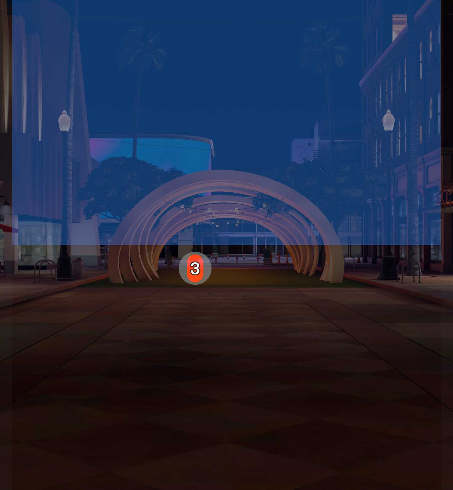

# Street Property Information for Specs

Street Property Information is an augmented-reality property discovery concept for Snap Specs. It places available apartment listings directly on the façade the user is viewing, keeping the connection between a listing and its real-world location visible.

## Experience

1. Look toward the highlighted building to see the number of available apartments.
2. Click or pinch the numbered cluster to reveal markers for the 1st, 3rd, and 8th floors.
3. Select a floor marker to open the apartment's status, room count, floor, bathrooms, and price.
4. Close the listing card or look away from the building to dismiss the information.

The Preview uses a translucent façade stand-in and hard-coded sample listings. A production version would replace these with building recognition, spatial alignment, and live listing data.

## Why Specs?

Property search normally forces people to stop, open a phone, search an address, and then match a listing back to a building. This Lens keeps the user's eyes up and anchors the information to the place it describes.

## Built with

- Lens Studio 5.23
- Spectacles Interaction Kit
- Spectacles UI Kit
- LEAF integration testing
- TypeScript

## Run the project

1. Install Lens Studio 5.22 or newer.
2. Clone this repository.
3. Open `SpecBuilding.esproj` in Lens Studio.
4. Select the **SPECS 27** device and **Interactive** Preview.
5. Click the Preview to focus it. Clicking an interactive control acts as a pinch.
6. Use `WASD` to move, `Q`/`E` to move vertically, and right-drag to look around.

The orange `3` marker is the starting interaction target.

## Tested behavior

Five LEAF scenarios run in Lens Studio Preview:

- `street_property_criterion_1_building` — building and reachable cluster marker
- `street_property_criterion_2_visibility` — show/hide based on distance and view
- `street_property_criterion_3_scatter` — cluster expands into three floor markers
- `street_property_criterion_4_listing` — listing card and connector appear with correct data
- `street_property_criterion_5_close` — close action hides the card and preserves markers

All five scenarios pass. See [devpost/leaf-results.md](devpost/leaf-results.md).

## Project structure

- `Assets/` — authored scripts, scene, materials, audio, and LEAF scenarios
- `Packages/` — Lens Studio package dependencies
- `devpost/` — design brief, submission copy, test report, and video plan
- `SpecBuilding.esproj` — Lens Studio project

## Prototype boundaries

The interaction logic and Preview rendering are proven. Real building recognition, live property data, long-term comfort, real hand-tracking feel, and alignment on physical Specs hardware remain unproven.

## Author

[Salih Yalcin](https://github.com/salihyalcin)

## License

MIT — see [LICENSE](LICENSE).
